# Roadmap diagrams: what Barthelona looks like when finished

Twelve drawings of the finished system, based on `docs/architecture.md`, `docs/roadmap.md` and the ADRs. Use them to check a delivered phase against the plan: every box is coloured by what exists on `main`, and the caption under each drawing names the phase that delivers it. The phases and exit criteria themselves are in `docs/roadmap.md`.

Colours (as of 2026-10-17, checked against `main`):

- green: exists on `main`;
- amber: in progress (Phase 0);
- grey: planned;
- blue hexagon: a human gate or a decision point;
- red: a rule that must never be broken (an invariant from `AGENTS.md`).

The drawings are hand-written SVG files in `docs/images/`. When a box lands, change its colour in the same PR that delivers it. If a drawing and `docs/architecture.md` disagree, the architecture wins and the drawing is fixed.

## 1. System and processes

The UI and the engine worker talk only through `var/app.sqlite`; every tool run goes through the WSL agent into the `bart-tc` and `bart-run` containers. Delivered: executors, store and toolchain probe in Phase 0; UI, engine worker and gateway backends in Phase 1.

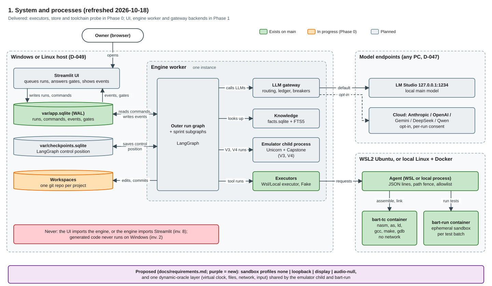

## 2. Package layering

Which package may import which (D-045). `ui` and `engine` never import each other, and the SDKs stay inside their own packages. Delivered: bottom layers in Phase 0; `nodes`, `engine` and `ui` in Phase 1.

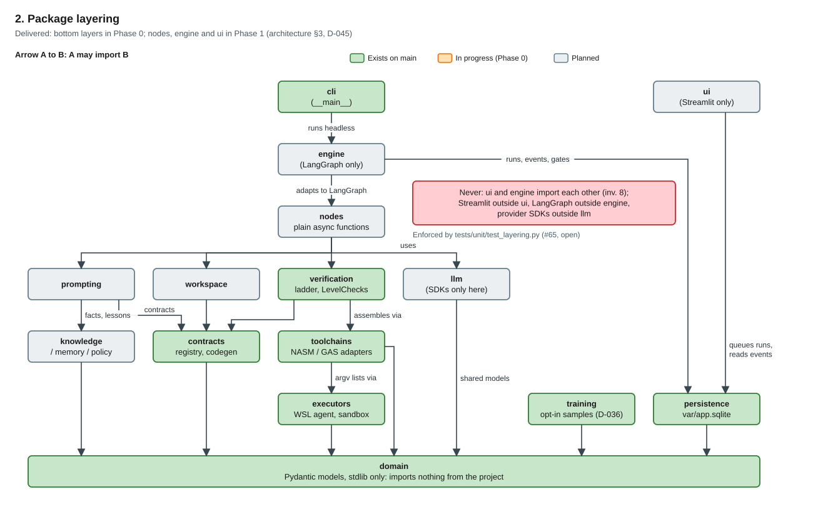

## 3. Run lifecycle: create and edit

The fixed outer run graph with the human gates G0 to G5. Delivered: create mode in Phase 1; edit of external projects in Phase 3.

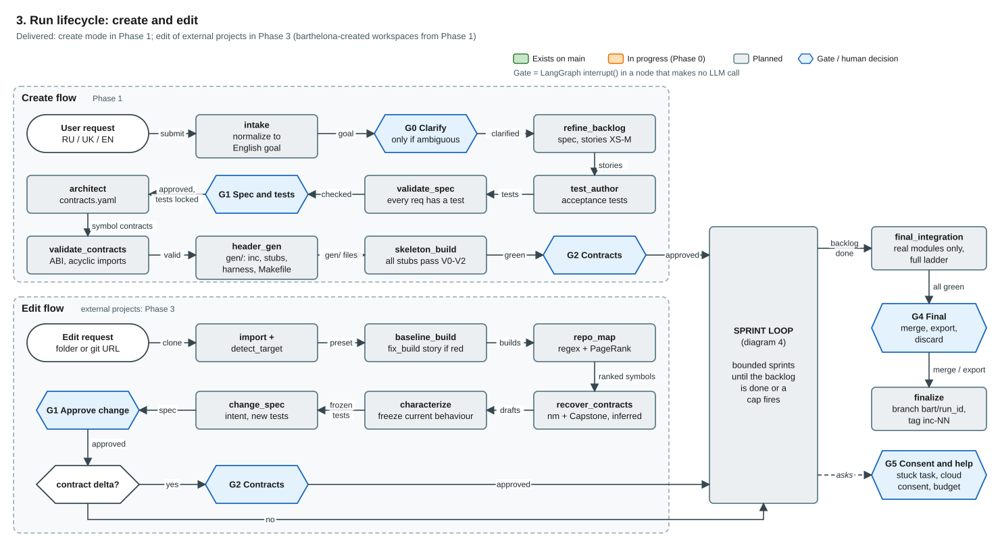

## 4. Meta-agentic sprint loop

The planner proposes, deterministic code composes and validates (T1-T10, two repairs, then the default template), and standup, review and retro loop back. Delivered: L0 in Phase 1a, L1 behind a flag in Phase 1b, L2 in Phase 2b.

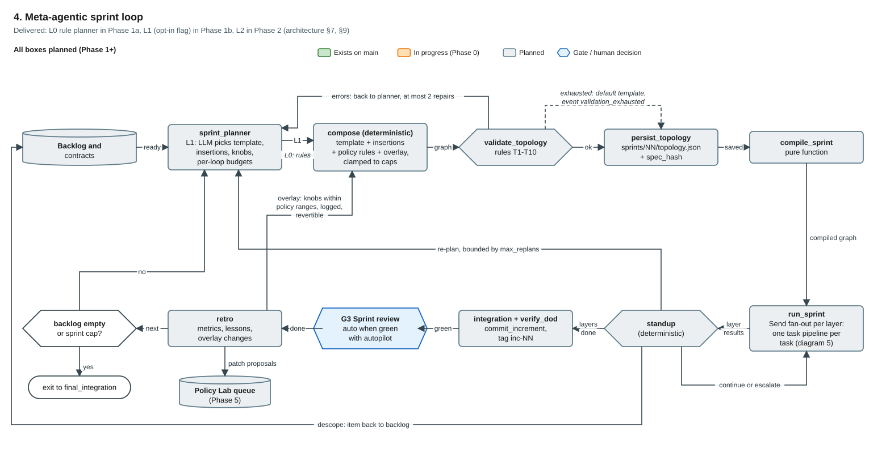

## 5. Task pipeline and escalation ladder

Inside one task: context, coder, envelope parse, atomic apply, tamper gate, ladder, fixer loop and escalation steps E1 to E4. Delivered: Phase 1; E2 candidates in Phase 2.

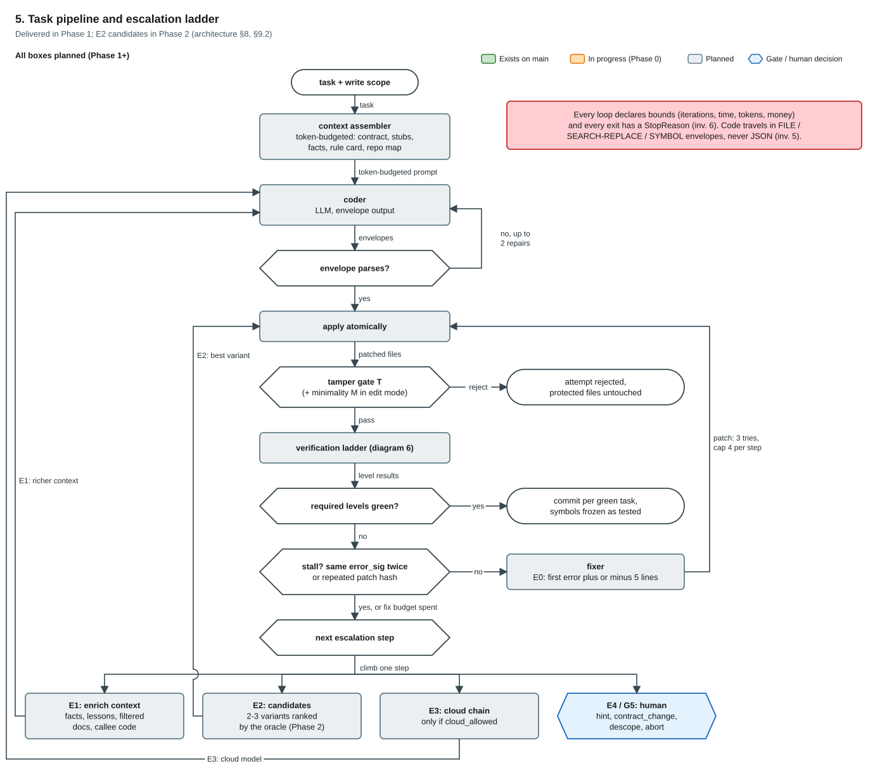

## 6. Verification ladder and gates

Cheapest check first; oracles decide. V4 is built only for the corpus kinds that V3 and a V5 canary miss (plan review, #102). Delivered: tamper gate, V0-V2, V5, V6 in Phase 0; V3 and the mutation corpus in Phase 2a.

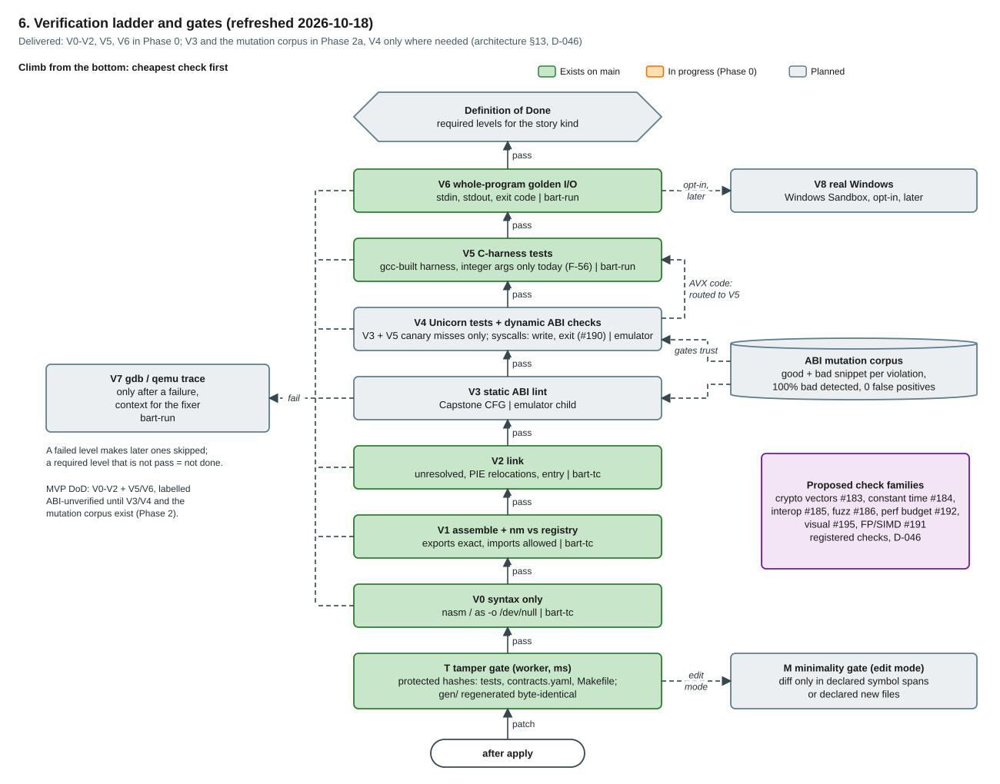

## 7. Execution, sandbox and crash consistency

How a tool run reaches a container (D-043, section 13.4 of the architecture), and the write order that makes a crash replay safely (D-044). Delivered: executors and images in Phase 0; crash spike in Phase 1.

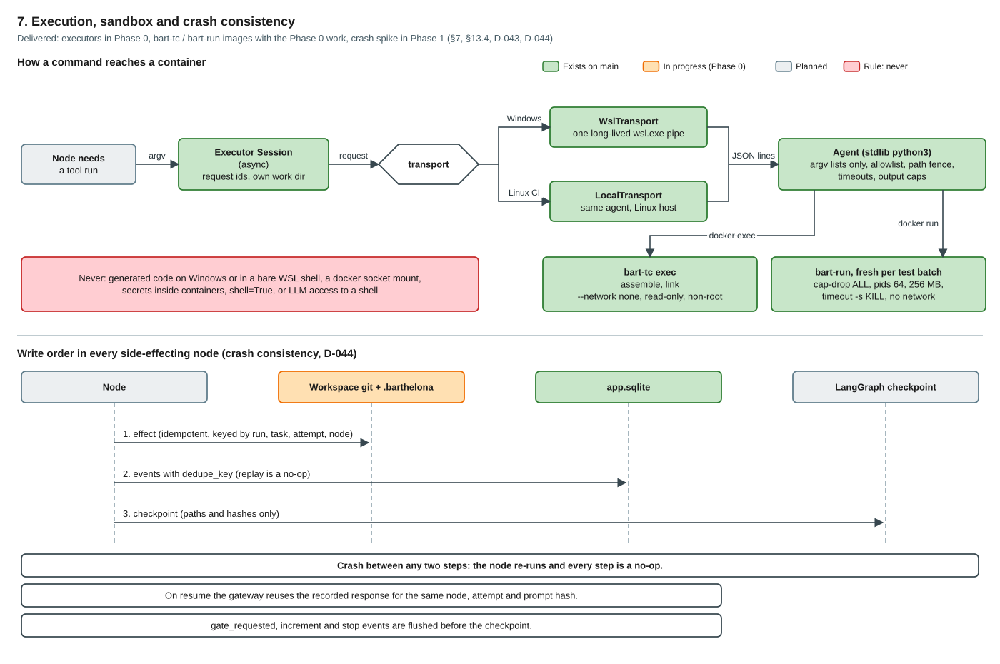

## 8. Model gateway and role chains

A role's call walks its model chain, skipping unavailable entries, and every chain ends in the local model (D-047). Delivered: minimal gateway in Phase 0 and 1a; all providers, breakers and caps in Phase 1b.

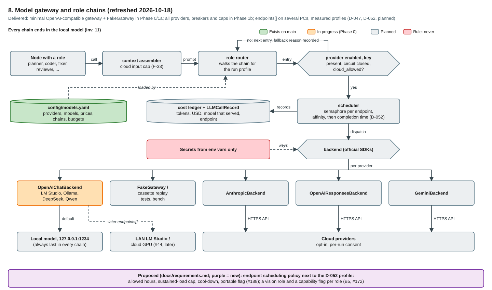

## 9. Data and workspace layout

Where each kind of truth lives: `var/`, the repository, and each project's own git workspace. Delivered: `app.sqlite` and codegen in Phase 0; the rest with their features.

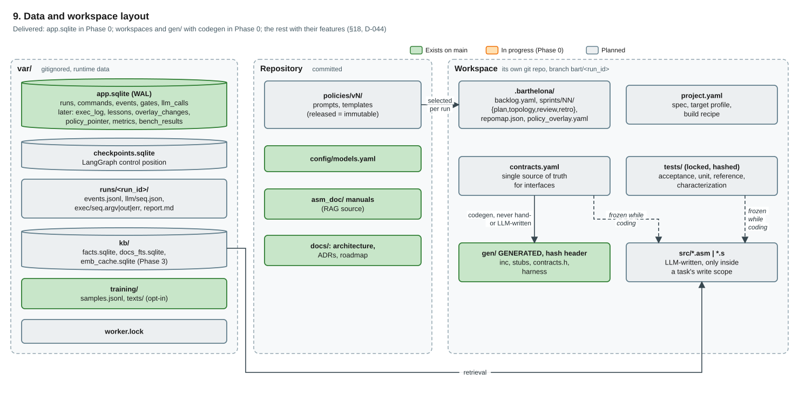

## 10. Phases and what each one adds

Phase 2 runs two tracks: 2a oracles plus the MCP server, 2b meta-agency (plan review, 2026-10-17). Each phase ends on its exit criterion plus the phase review (D-037).

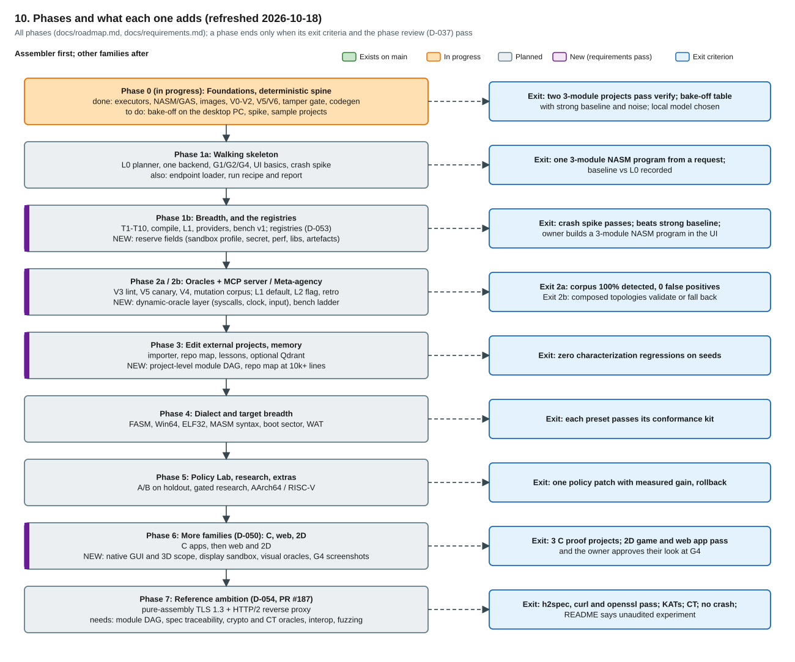

Phases 6 and 7 and the purple "new" marks were added on 2026-10-18 from `docs/requirements.md`. Drawings 1, 6 and 8 got a text refresh and a purple "proposed" box in the same pass (Linux host and multi-PC endpoints, new check families, endpoint scheduling policy); a full redraw happens when their phases land.

## 11. Capabilities the reference workloads need

Capabilities derived from the hardest version of each demo, coloured by status. Source: `docs/requirements.md` section 2.

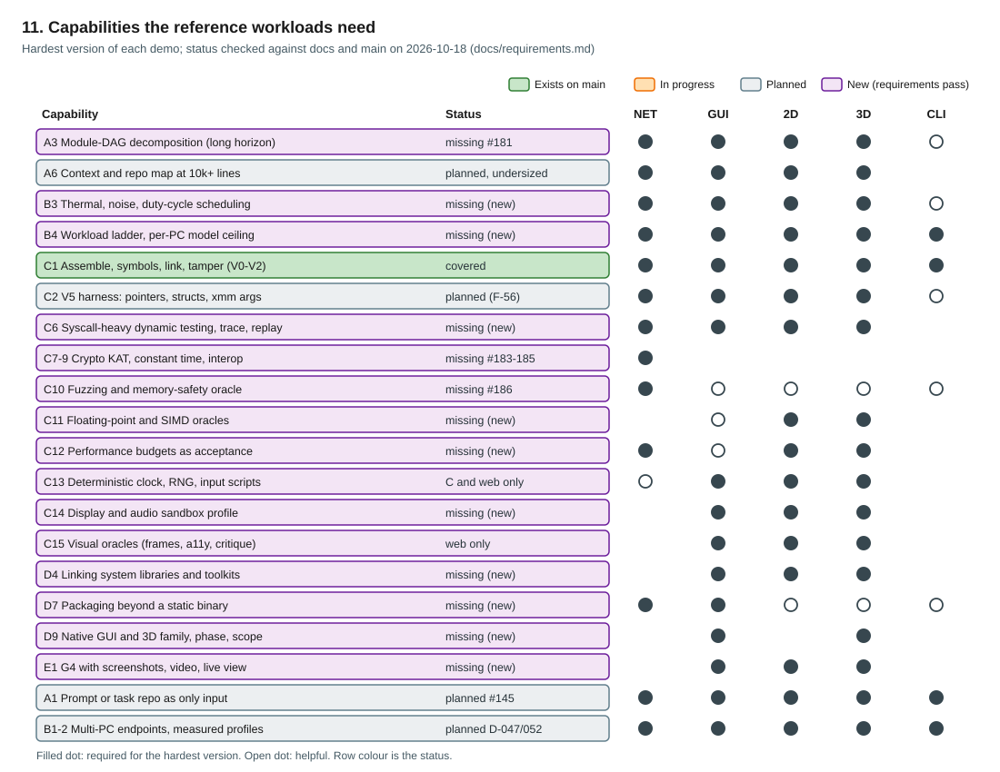

## 12. Proposed architecture changes

What the requirements pass proposes to add to the engine, mostly as reserved fields and registries before Phase 1b freezes schemas. Source: `docs/requirements.md` section 4.

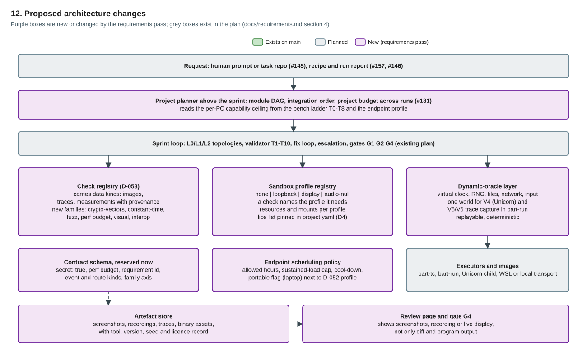
