# Roadmap diagrams: what Barthelona looks like when finished

Ten diagrams of the finished system, drawn from `docs/architecture.md` and the accepted-for-now ADRs. Use them to check a delivered phase against the plan: every box says whether it exists today, and the caption under each diagram names the phase that delivers it. The roadmap itself is `docs/roadmap.md`.

Status colours (as of 2026-10-17, from `main`; check `docs/roadmap.md` before relying on a box being built):

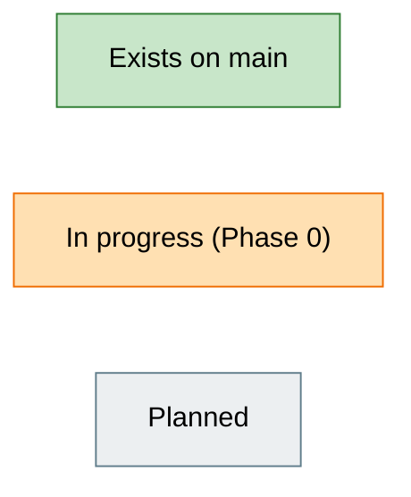

Keep the diagrams current: when a box lands, change its class in the same PR. If a diagram and the architecture disagree, `docs/architecture.md` wins and the diagram is fixed.

| # | Diagram | Architecture section | Delivered in |
| --- | --- | --- | --- |
| 1 | System and processes | §3 | Phase 0 (spine), Phase 1 (UI, engine) |
| 2 | Package layering | §3, D-045 | Phase 0 onward |
| 3 | Run lifecycle: create and edit | §6 | Phase 1 (create), Phase 3 (edit of external projects) |
| 4 | Meta-agentic sprint loop | §7, §9 | Phase 1a (L0), 1b (L1), Phase 2 (L2) |
| 5 | Task pipeline and escalation ladder | §8, §9.2 | Phase 1 |
| 6 | Verification ladder and gates | §13, D-046 | Phase 0 (V0-V2, V5, V6), Phase 2 (V3, V4) |
| 7 | Execution, sandbox and crash consistency | §7, §13.4, D-043, D-044 | Phase 0 (executors), Phase 1 (crash spike) |
| 8 | Model gateway and role chains | §16, D-047 | Phase 0 (minimal), Phase 1b (all providers) |
| 9 | Data and workspace layout | §18 | Phase 0 (store), Phase 1 onward |
| 10 | Phases and what each one adds | `docs/roadmap.md` | all |

## 1. System and processes

Two Windows processes talk only through SQLite; everything that runs generated code lives in WSL Docker containers or the emulator child. Delivered: executors, store and toolchain probe in Phase 0; the UI, worker and gateway backends in Phase 1.

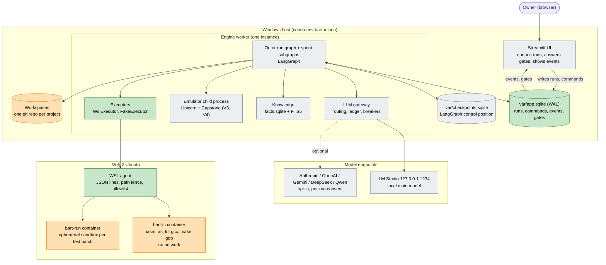

## 2. Package layering

Arrows point from a package to what it may import; nothing imports `ui` or `cli`, and the engine never touches Streamlit (invariant 8). Enforced by `tests/unit/test_layering.py` once #65 lands. Delivered: bottom layers in Phase 0, `nodes`, `engine`, `ui` in Phase 1.

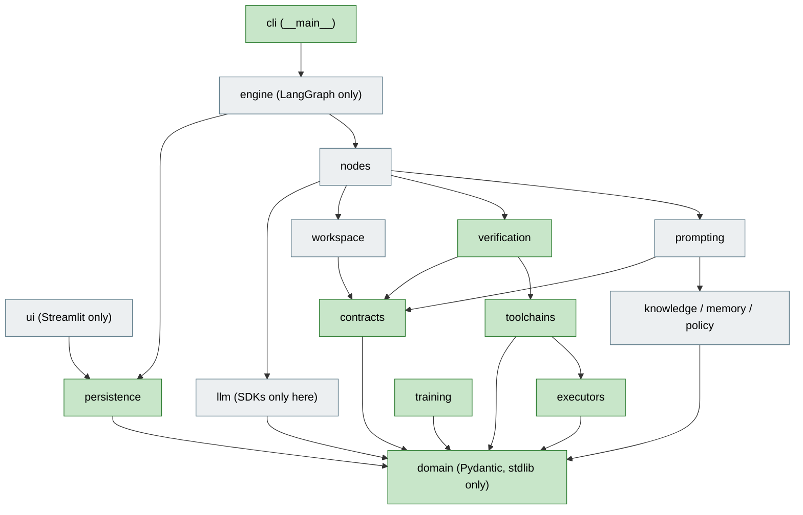

`ui` and `engine` never import each other. The edges shown are the main ones; the full table is in architecture §3.

## 3. Run lifecycle: create and edit

The outer run graph is fixed code. Green rectangles are human gates (G0-G5); each gate is a LangGraph `interrupt()` in a node that makes no LLM call. Create mode is delivered in Phase 1; edit mode for external projects in Phase 3 (barthelona-created workspaces can be edited from Phase 1).

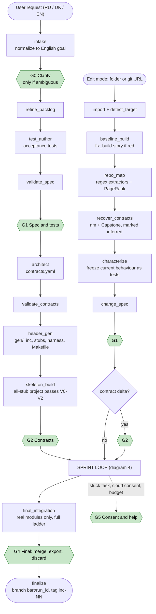

## 4. Meta-agentic sprint loop

The AI proposes, deterministic code decides: the planner emits a request, `compose` builds the graph, rules T1-T10 validate it, and an invalid graph falls back to the policy's default template after two repairs. The run is never blocked. L0 (rule-based) is the Phase 1a default and always the fallback; L1 arrives in Phase 1b as an opt-in flag, L2 in Phase 2.

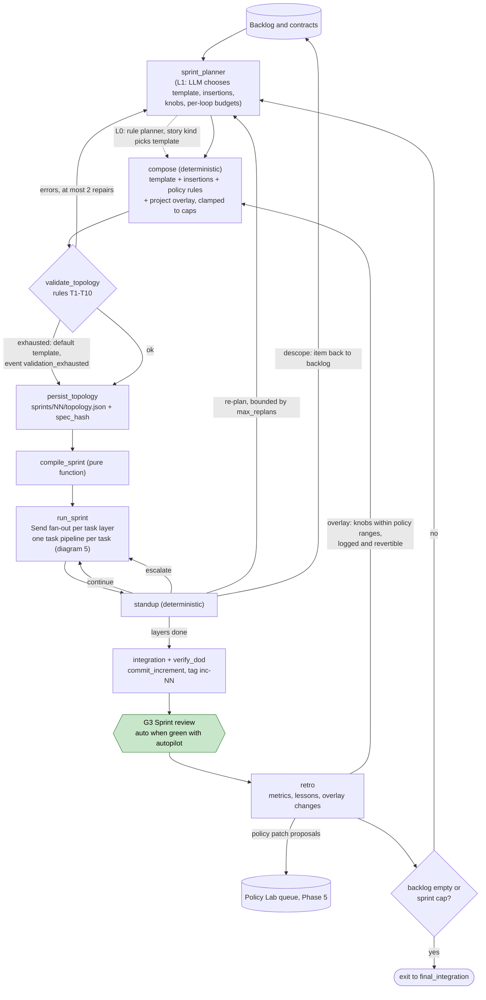

## 5. Task pipeline and escalation ladder

Inside one task: generate, apply, gate, climb the ladder, fix. Every loop declares bounds (iterations, time, tokens, money) and every exit has a `StopReason` (invariant 6). Code travels in FILE / SEARCH-REPLACE / SYMBOL envelopes, never JSON. Delivered in Phase 1; `candidates` (E2) in Phase 2.

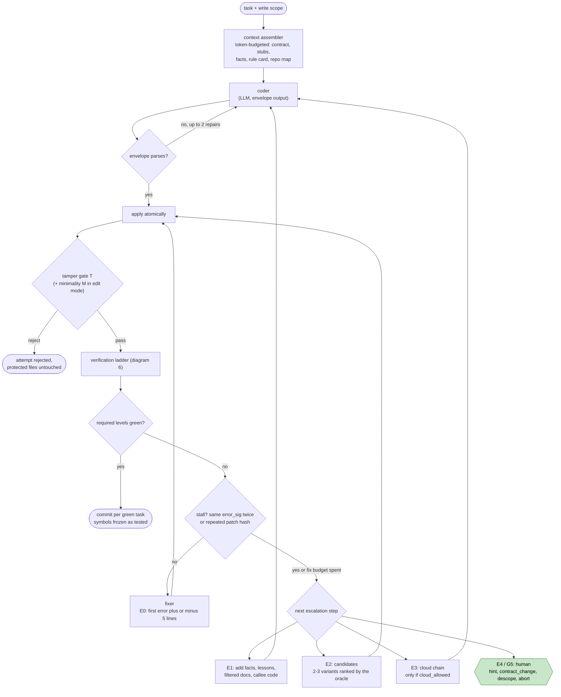

## 6. Verification ladder and gates

Cheapest check first; oracles decide, models only propose (invariant 1). Each level is a registered `LevelCheck` per target family (D-046); a failed level makes later ones `skipped`. MVP Definition of Done is V0-V2 plus V5/V6, labelled ABI-unverified until V3/V4 and the mutation corpus exist (Phase 2). Today V0-V2 exist; V5/V6 need the `bart-run` executor (#47).

```mermaid
flowchart LR
    apply(["after apply"]) --> t["T tamper gate<br/>hashes of tests, contracts.yaml,<br/>Makefile, gen/ regenerated"]:::planned
    t --> v0["V0 syntax only<br/>nasm / as"]:::done
    v0 --> v1["V1 assemble +<br/>nm vs registry"]:::done
    v1 --> v2["V2 link:<br/>unresolved, PIE, entry"]:::done
    v2 --> v3["V3 static ABI lint<br/>Capstone CFG"]:::planned
    v3 --> v4["V4 Unicorn tests +<br/>dynamic ABI checks"]:::planned
    v4 --> v5["V5 C-harness tests<br/>in bart-run"]:::wip
    v5 --> v6["V6 whole-program golden I/O<br/>in bart-run"]:::wip
    v6 --> dod{"Definition of Done<br/>for story kind"}:::planned
    v5 -. "AVX code routed here" .-> v4
    fail(["any failure"]) -.-> v7["V7 gdb / qemu trace<br/>context for the fixer"]:::planned
    v6 -. "opt-in, later" .-> v8["V8 real Windows<br/>Windows Sandbox"]:::planned
    t -. "edit mode" .-> m["M minimality gate<br/>diff only in declared symbol spans"]:::planned
    mut[("ABI mutation corpus<br/>100% bad detected, 0 false positives")]:::planned -. "gates trust in V3 / V4" .-> v3

    classDef done fill:#c8e6c9,stroke:#2e7d32,color:#000
    classDef wip fill:#ffe0b2,stroke:#ef6c00,color:#000
    classDef planned fill:#eceff1,stroke:#607d8b,color:#000
```

## 7. Execution, sandbox and crash consistency

Top: how a command reaches a container and what the sandbox forbids (D-043, §13.4). Bottom: the write order in every side-effecting node, which makes a crash at any point replay safely (D-044). Executors are delivered in Phase 0, the images with the Phase 0 `bart-tc` / `bart-run` work, the crash spike in Phase 1.

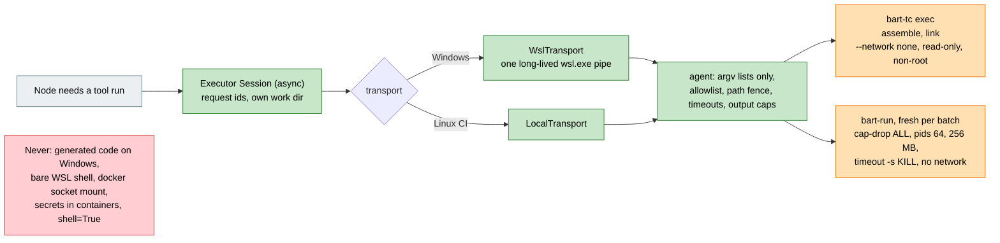

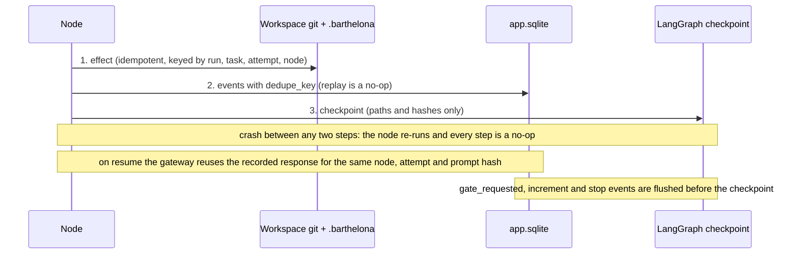

## 8. Model gateway and role chains

Every role has a chain per profile that ends in the local model, so a dead or broke cloud provider is an event, never a crash (invariant 11). Calls are scheduled per (endpoint, model) because a model reload costs seconds to minutes (D-047, D-039 caching). Delivered: minimal OpenAI-compatible gateway plus `FakeGateway` in Phase 0 and 1a; all providers, breakers and caps in Phase 1b; second PC and rented GPU endpoints in Phase 2 or later (#44).

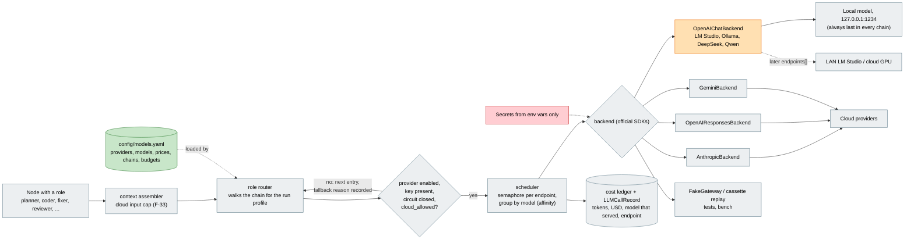

## 9. Data and workspace layout

Where each kind of truth lives (D-044): git owns artifacts, `app.sqlite` owns the operator-visible record, the checkpoint owns only the control position. Delivered: `app.sqlite` in Phase 0; workspaces and `gen/` with codegen in Phase 0; the rest with their features.

```mermaid
flowchart TB
    subgraph var["var/ (gitignored)"]
        app[("app.sqlite WAL<br/>runs, commands, events, gates, llm_calls<br/>later: exec_log, lessons, overlay_changes,<br/>policy_pointer, metrics, bench_results")]:::done
        ck[("checkpoints.sqlite<br/>LangGraph")]:::planned
        runs["runs/run_id/<br/>events.jsonl, llm/seq.json,<br/>exec/seq.argv|out|err, report.md"]:::planned
        kbd[("kb/<br/>facts.sqlite, docs_fts.sqlite,<br/>emb_cache.sqlite (Phase 3)")]:::planned
        tr["training/<br/>samples.jsonl, texts/ (opt-in)"]:::done
        lock["worker.lock"]:::planned
    end

    subgraph repo["Repository (committed)"]
        cfg["config/models.yaml"]:::done
        pol["policies/vN/<br/>prompts, templates (released = immutable)"]:::planned
        asmdoc["asm_doc/ manuals (RAG source)"]:::done
        docs["docs/: architecture, ADRs, roadmap"]:::done
    end

    subgraph wsp["Workspace = its own git repo, branch bart/run_id"]
        proj["project.yaml<br/>spec, target profile, build recipe"]:::planned
        con["contracts.yaml<br/>single source of truth for interfaces"]:::planned
        src["src/*.asm | *.s<br/>LLM-written, only inside a task's write scope"]:::planned
        gen["gen/ GENERATED, hash header<br/>inc, stubs, contracts.h, harness"]:::wip
        tst["tests/ (locked, hashed)<br/>acceptance, unit, reference, characterization"]:::planned
        bart[".barthelona/<br/>backlog.yaml, sprints/NN/{plan,topology,review,retro},<br/>repomap.json, policy_overlay.yaml"]:::planned
    end

    con -- "codegen, never hand- or LLM-written" --> gen
    con -. "frozen while coding" .-> src
    tst -. "frozen while coding" .-> src
    pol -- "selected per run" --> bart
    kbd -- "retrieval" --> src

    classDef done fill:#c8e6c9,stroke:#2e7d32,color:#000
    classDef wip fill:#ffe0b2,stroke:#ef6c00,color:#000
    classDef planned fill:#eceff1,stroke:#607d8b,color:#000
```

## 10. Phases and what each one adds

Each phase ends only when its exit criteria and the phase review (D-037) pass. Phase 1 is split into 1a (walking skeleton, L0 only) and 1b (breadth). Assembler first: other languages and WASM come after the assembler phases.

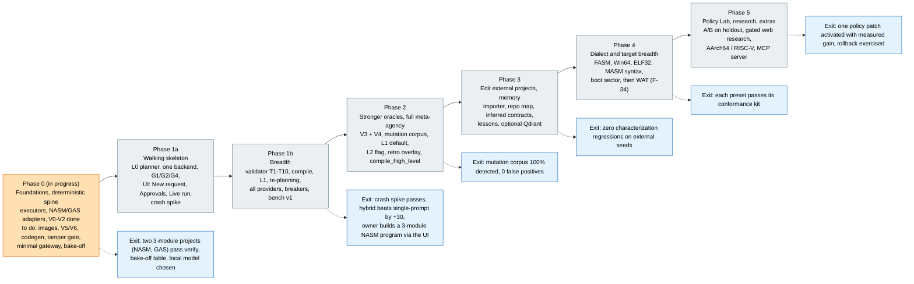
